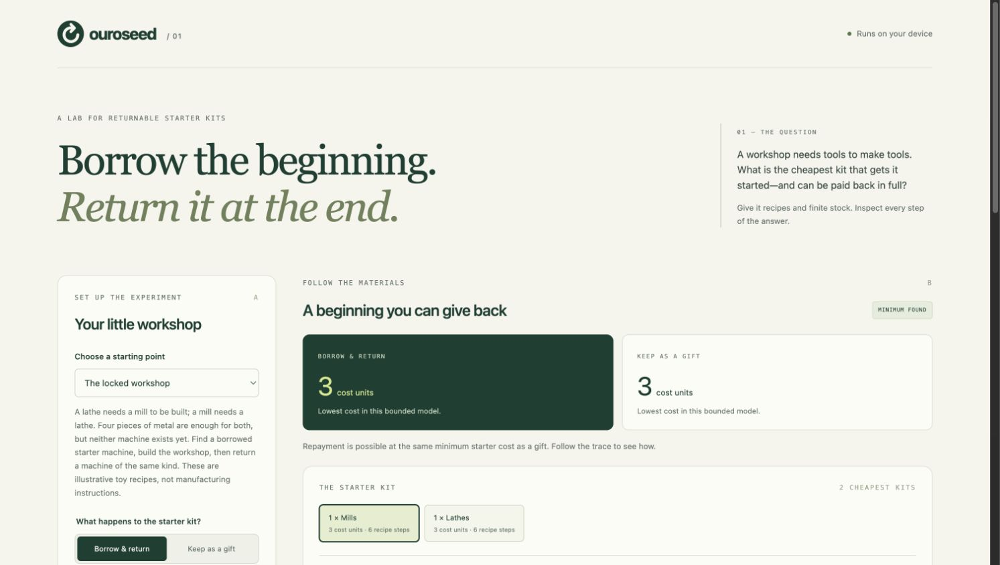

# Ouroseed

**Borrow the beginning. Return it at the end.**

Ouroseed finds the cheapest temporary resource kit that can start a circular production system, complete its goal, and return every borrowed quantity. It gives you a sequence you can replay, inspect, export, and independently verify.

A lathe needs a mill to be built. A mill needs a lathe. You have enough metal for both, but neither machine. Borrow one machine, build both, and return one of the borrowed kind. What if you only have enough material to build one? A connected dependency diagram does not answer that question; finite inventory does.

This is a small, working planning instrument with a browser interface and CLI. No AI API, account, backend, package installation, or runtime dependencies are required.



## Try it

Requires **Node.js 20 or later**.

```sh
git clone https://github.com/ChinmayUdaybhanuThakur/ouroseed.git
cd ouroseed
npm start
```

Open **http://127.0.0.1:4173**. The default scenario runs automatically. Select a kit, step through its plan, and inspect the inventory before and after returning the loan. Switch to **Gift** to see what changes when repayment is removed. Use the JSON editor to create your own model.

`npm run build` produces `dist/` for any static HTTP host. ES modules and module workers require HTTP(S); double-clicking `index.html` is not supported. The app processes models locally in your browser, with no telemetry or external fonts.

## What it does

- Enumerates starter kits in increasing user-defined integer cost.
- Searches actual finite inventory states, with reusable equipment, consumed inputs, produced outputs, and hard capacity limits.
- Returns **all equally cheapest kits**, and one shortest recipe sequence per kit.
- Compares loans against gifts, and checks whether the goal is reachable with no outside kit.
- Replays inventory changes and repayment in an interactive timeline.
- Exports portable JSON witnesses checked by a separate implementation that does not import the planner.
- Reports **inconclusive** when computation runs out; a timeout is never reported as impossibility.

## Four experiments

| Example | Loan result | Gift result | What it demonstrates |
| --- | --- | --- | --- |
| `locked-workshop.json` | Cost 3; two kits; 6 steps each | Cost 3; 3 steps each | Borrow either machine, build both, return a machine |
| `shared-consumable.json` | Infeasible | Infeasible | Competing recipes cannot both spend the same stock |
| `borrowed-battery.json` | Infeasible | Cost 2; 1 step | An imported resource can be consumed without being replaceable |
| `regenerative-starter.json` | Cost 1; 3 steps | Cost 1; 2 steps | A consumed starter can be regenerated and repaid |

Costs are arbitrary model weights, not currency. Recipes are illustrative abstractions, not validated manufacturing or chemical processes.

## CLI

```sh
node src/cli.js solve examples/locked-workshop.json --mode loan --witness plan.json
node src/cli.js verify plan.json
node src/cli.js solve examples/borrowed-battery.json --mode gift
node src/cli.js solve examples/locked-workshop.json --states 20000 --candidates 2048
```

The solver prints JSON. A witness file is created only when a feasible plan exists, and existing files are never overwritten by `--witness`. Exit codes: `0` optimal/valid, `1` invalid input/witness, `2` infeasible, `3` inconclusive. A verified witness proves feasibility under its **embedded model**, not authenticity of the model, physical truth, or optimality. Review the model before trusting a plan.

## The precise question

For inventory vector `x`, kit `s`, and required retained inventory `g`:

```text
start = initial + s
fire a recipe only if x >= consume + require
next = x - consume + produce, with 0 <= next <= capacity
loan finish: x >= g + s          gift finish: x >= g
loan retained inventory = x - s
minimize sum(seedCost[i] * s[i])
```

Repayment uses quantities of interchangeable resources, not tracking the identity of a specific borrowed machine. Existing inventory not included in `goal` may be consumed. Recipe firings are sequential and atomic; a reusable requirement remains available after a firing. Capacity is a real constraint: overflowing transitions are rejected, never clipped.

See [the model specification](docs/MODEL.md) for the schema, examples, bounds, and assumptions.

## Exact within a declared boundary

Breadth-first search checks each kit; a lazy priority queue enumerates kits by cost. If all cheaper and equally priced candidates were resolved, `optimal` means cheapest within the declared model, capacities, and permitted kit quantities. `infeasible` means exhaustive failure within those same bounds. Neither says anything about omitted recipes or larger capacities.

The defaults are 20,000 states **per kit** and 2,048 candidate kits. The browser additionally cancels after ten seconds. State spaces can grow exponentially; this version is for small systems. It does not model time, parallel jobs, uncertainty, machine identity, wear unless explicitly represented, or indefinite self-maintenance. Reaching one final goal is not a proof of industrial self-sufficiency.

## Originality and prior work

Ouroseed is an original implementation of a particular borrow/build/repay workflow. Targeted searches on **6 November 2026** did not reveal an identical product. That is **not proof that none exists anywhere**, nor a claim to new Petri-net mathematics or a patentable invention.

Minimum initial markings, metabolic seed sets, and transient seeds that are regenerated all have substantial prior art. The [research record](docs/PRIOR_ART.md) names the closest tools and papers, explains overlaps, and limits the novelty claim. In particular, see [Seed2LP](https://github.com/bioasp/seed2lp) and [Peng et al. (2022)](https://journals.plos.org/ploscompbiol/article?id=10.1371/journal.pcbi.1010498).

## Verify the implementation

```sh
npm test
npm run build
```

Tests include independent exhaustive oracles, all example outcomes, equal-cost alternatives, resource conflicts, reusable/consumed overlap, hard capacities, shortest plans, malformed models, tampered witnesses, and budget boundaries. CI runs the same checks on Node 20, 22, and 24.

## Layout

```text
src/engine.js     validated model, finite-state search, kit optimization
src/verify.js     independent witness replay, no planner imports
src/worker.js     browser computation off the main thread
src/app.js        interactive workbench
src/cli.js        solve and verify commands
examples/        four small reproducible systems
tests/           specification and independent oracle checks
docs/            model semantics and prior-art investigation
```

MIT licensed. Contributions that improve counterexamples, verification, or scalability are welcome. Please preserve the distinction between a feasible witness, bounded optimality, and claims about the physical world.
